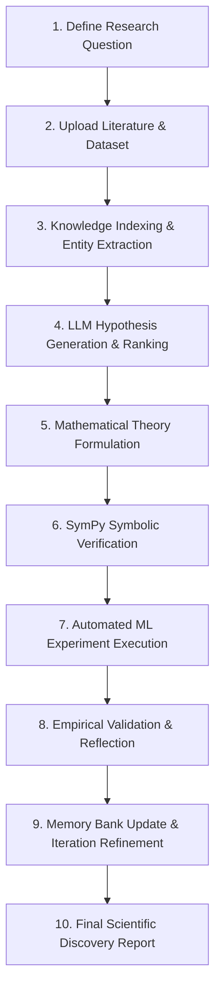

# 📖 Autonomous Theory Discovery Platform - User Guide

Welcome to the **User Guide** for the **Autonomous Theory Discovery Platform**! This guide walks you through every step of using the application to execute AI-driven scientific discovery, formulate mathematical theories, run automated machine learning experiments, and generate scientific research reports.

---

## 🧭 System Overview & Discovery Workflow

The platform automates the traditional scientific method into an autonomous, closed-loop loop:



---

## 🚀 Step-by-Step Usage Guide

### Step 1: Accessing the Dashboard

1. Launch both the backend (`uvicorn app.main:app --reload`) and frontend (`npm run dev`).
2. Open your web browser and navigate to `http://localhost:5173`.
3. The **Dashboard** displays active research projects, platform statistics (total hypotheses, theories, experiments run), and quick action controls.

---

### Step 2: Creating a New Research Project

1. Click **"New Project"** or **"Create Project"** in the top navigation bar or sidebar.
2. Fill in the project details:
   * **Project Name**: e.g., *Nonlinear Feature Selection in High-Dimensional Datasets*
   * **Research Question**: State your scientific problem (e.g., *How can we combine mutual information metrics with decision-tree node impurity to eliminate noisy features without degrading classification performance?*)
   * **Domain**: Select domain (e.g., *Computer Science / Machine Learning*, *Biomedical Science*, *Physics*).
   * **Max Iterations**: Specify loop depth (default: `3` iterations).
3. Click **"Create Project"**.

---

### Step 3: Uploading Datasets and Literature

1. On the **Project Details** page, locate the **"Literature & Files"** panel.
2. **Upload Literature**:
   * Drag and drop PDF or DOCX research papers into the upload box.
   * Click **"Upload Literature"**.
   * The system will automatically parse text content and index relevant domain concepts.
3. **Upload Dataset (CSV)**:
   * Drag and drop target CSV dataset files.
   * *Note*: If no dataset is uploaded, the system automatically initializes a benchmark dataset (e.g. Heart Disease benchmark dataset) for execution.

---

### Step 4: Executing Autonomous Closed-Loop Discovery

1. Click the **"🚀 Run Autonomous Discovery"** button on the project header.
2. The system initiates the multi-step closed loop:
   * **Processing Documents**: Extracts domain entities and builds a Knowledge Graph.
   * **Generating Hypotheses**: Uses NVIDIA Nemotron Reasoning LLM to propose testable hypotheses.
   * **Formulating Theories**: Converts top hypotheses into mathematical equations.
   * **Verifying Consistency**: Evaluates math equations using SymPy.
   * **Running Experiments**: Executes Pandas/Scikit-learn algorithms on the dataset.
   * **Reflecting & Learning**: Saves empirical feedback into the scientific memory bank.
3. Track real-time progress in the live progress bar and status indicator.

---

### Step 5: Reviewing Discovery Artifacts

Navigate through the project tabs to inspect discovery artifacts:

#### 💡 Hypotheses Tab
* Views generated hypotheses ranked by **Novelty**, **Testability**, and **Relevance**.
* Displays confidence scores and rationale.

#### 📐 Formulated Theories Tab
* Shows formulated mathematical expressions (rendered with LaTeX).
* Displays SymPy verification status (*Verified*, *Inconsistent*, or *Syntax Warning*).

#### 🧪 Experiments Tab
* Shows empirical execution metrics (Accuracy, F1 Score, R² score, Feature Importances).
* Displays execution logs and performance graphs comparing baseline vs hypothesis-guided models.

#### 🧠 Knowledge & Memory Tab
* Displays extracted Knowledge Graph entities (Concepts, Models, Metrics).
* View reflection logs accumulated across iterations.

---

### Step 6: Generating & Exporting Reports

1. Navigate to the **Reports** tab or click **"Generate Final Discovery Report"**.
2. The system compiles all findings into a structured scientific paper format:
   * **Title & Abstract**
   * **Problem Formulation & Literature Context**
   * **Top Candidates & Formulated Theories**
   * **Empirical Validation Results & Performance Comparison**
   * **Conclusion & Future Directions**
3. Click **"Download Report"** to save as Markdown or print to PDF.

---

## ⚙️ Configuration & Environment Settings

You can customize the API key and model parameters in `backend/.env`:

```env
# NVIDIA NIM API Settings
NVIDIA_API_KEY=nvapi-your-key-here
NVIDIA_MODEL=nvidia/nemotron-3-nano-omni-30b-a3b-reasoning
NVIDIA_BASE_URL=https://integrate.api.nvidia.com/v1

# Alternative LLM Provider Keys
OPENAI_API_KEY=
GEMINI_API_KEY=
```

---

## ❓ Frequently Asked Questions (FAQ)

**Q: Do I need an NVIDIA GPU locally to run this?**  
A: No! The platform calls NVIDIA's cloud-hosted NIM API (`integrate.api.nvidia.com`), so all heavy AI reasoning is computed on cloud infrastructure.

**Q: What happens if an experiment fails or yields poor accuracy?**  
A: The system's reflective memory engine logs the failure, updates hypothesis ranking constraints, and generates refined candidate theories in subsequent iterations.

**Q: Can I use custom Python scripts in experiments?**  
A: Yes, the experiment engine can be extended in `backend/app/services/experiment_service.py` to support custom domain execution scripts.
