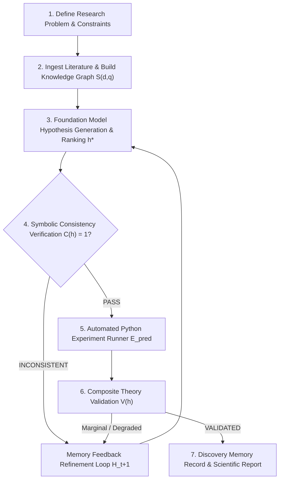

# 📖 Autonomous Theory Discovery Platform - User Guide

Welcome to the **User Guide** for the **Autonomous Theory Discovery Platform**! This guide walks you through every step of using the application to execute AI-driven scientific discovery, formulate mathematical theories, run automated machine learning experiments, and generate empirical research reports based on the methodology paper (*Autonomous Theory Discovery using Foundation Models*).

---

## 🧭 System Overview & Formal Discovery Methodology

The platform automates the scientific method into a rigorous, closed-loop discovery cycle:



### Theoretical Equations Implemented per the Paper:
* **Knowledge Retrieval (Eq. 1):** $S(d,q) = f_{\text{rel}}(d,q)$ using TF-IDF cosine similarity and named entity graph extraction.
* **Hypothesis Ranking (Eq. 2 & 3):** $h^* = \arg\max P(h \mid K, C)$ evaluated via:
  $$\text{Score}(h) = 0.30 \cdot \text{Plausibility} + 0.20 \cdot \text{Novelty} + 0.25 \cdot \text{Testability} + 0.25 \cdot \text{Consistency}$$
* **Mathematical Consistency (Eq. 4):** $C(h) \in \{0, 1\}$ verified via SymPy symbolic algebra.
* **Empirical Prediction Error (Eq. 5):** $E_{\text{pred}} = \frac{1}{N} \sum_{i=1}^{N} |y_i - \hat{y}_i|$ evaluated against baseline models.
* **Composite Candidate Validation (Eq. 6):**
  $$V(h) = \alpha C(h) + \beta A(h) + \gamma N(h) + \delta R(h)$$
  *(Configurable weights $\alpha, \beta, \gamma, \delta$ accessible in the Settings panel).*
* **Discovery Memory Update (Eq. 7):** $H_{t+1} = F(H_t, E_t, M_t)$ feeding back failed and refined strategies to avoid repeating prior negative results.

---

## 🚀 Step-by-Step Usage Guide

### Step 1: Accessing the Dashboard & Navigation

1. Launch both the backend and frontend:
   ```bash
   # Terminal 1: Backend
   cd backend
   python -m uvicorn app.main:app --reload --port 8000

   # Terminal 2: Frontend
   cd frontend
   npm run dev
   ```
2. Open your web browser and navigate to `http://localhost:5173` (or port `8000` to view the unified production bundle).
3. The left sidebar provides direct access to all core modules:
   * **Discovery Studio (`Home`):** Interactive prompt input, project overview, and quick execution.
   * **Closed-Loop Pipeline (`Layers`):** Interactive methodology flowchart connected to real-time project telemetry.
   * **Knowledge Retrieval (`BookOpen`):** Extracted scientific literature findings and entity graph.
   * **Hypothesis Generator (`Lightbulb`):** Multi-dimensional candidate hypotheses ranked by Eq. 2.
   * **Automated Experiments (`Cpu`):** Generated Python experiment code, execution runtime, and baseline comparisons.
   * **Composite Validation (`ShieldCheck`):** Metric improvements, consistency, novelty, and reproducibility scores ($V(h)$).
   * **Discovery Memory (`History`):** Accumulated iteration records and failure feedback ($H_{t+1}$).
   * **Paper Benchmarks (`BarChart3`):** Tables II & III performance criteria comparison.

---

### Step 2: Creating a New Research Workspace

1. Click **"New Research Problem"** on the Dashboard or **"Create Project"** in navigation.
2. Complete the configuration form:
   * **Problem Title:** Formulate a concise scientific title (e.g., *Feature Selection Optimization for High-Dimensional Tabular Classification*).
   * **Research Question:** State the research question (e.g., *Can hybrid mutual information and tree-based importance filtering eliminate uninformative features without degrading F1 score?*).
   * **Domain:** Choose *Machine Learning*, *Deep Learning*, *Data Mining*, or *Optimization*.
   * **Objective:** e.g., *Maximize F1 score while reducing feature count by at least 30%*.
   * **Constraints:** Operational boundaries (e.g., *Non-negative feature weights; bounded runtime latency*).
   * **Evaluation Metric:** e.g., *F1 Score*, *Accuracy*, or *RMSE*.
   * **Max Iterations:** Discovery depth (default: `3` iterations).
3. **Attach Research Materials:**
   * **Dataset (.csv):** *(Required)* Upload your target tabular dataset.
   * **Literature (.pdf, .docx, .txt):** *(Optional but recommended)* Upload domain research papers for knowledge extraction.
4. Click **"Create Project & Launch Workspace"**.

---

### Step 3: Executing Closed-Loop Autonomous Discovery

1. From the project details page, click **"🚀 Run Closed-Loop Discovery Pipeline"** (or use the launch button on the Dashboard).
2. The closed loop executes autonomously across all phases:
   * **Knowledge Extraction:** Extracts scientific terms and builds relationship triples.
   * **LLM Hypothesis Generation:** Queries the active foundation model with problem context, retrieved literature, and past iteration failures.
   * **Ranking Candidates:** Computes composite scores per PDF Equation 2.
   * **Theory Construction:** Converts the top candidate into formal algorithmic logic and mathematical notation.
   * **SymPy Symbolic Verification:** Checks mathematical consistency $C(h)$.
   * **Automated Experiment Execution:** Generates an isolated Python script, executes a 5-fold cross-validation or train/test split, and measures baseline vs proposed metrics.
   * **Composite Validation:** Computes $V(h)$ per Equation 6 and decides whether to **Validate**, **Refine**, or **Reject**.
   * **Memory Update:** Records negative and positive outcomes into $H_{t+1}$ to inform subsequent iterations.
3. If an iteration yields marginal improvements, the system automatically triggers a refinement cycle with failure feedback until a candidate is validated or maximum iterations are reached.

---

### Step 4: Inspecting Artifacts & Live Telemetry

* **Methodology Flowchart:**
  Use the workspace selector at the top of the flowchart to inspect any project. The illuminated path and node badges dynamically reflect the exact real-time progress and metric state stored in the database.
* **Hypotheses Panel:**
  Inspect individual candidate hypotheses, reading their scientific rationale, expected effect, plausibility, novelty, testability, and consistency scores.
* **Experiments Panel:**
  Inspect the exact Python code written and executed by the AI, as well as runtime execution speeds, baseline metrics, and proposed metrics.
* **Validation Panel:**
  Review the decision breakdown explaining why a theory candidate was approved, refined, or rejected.

---

### Step 5: Generating and Exporting Reports

1. In any project workspace, navigate to the **Reports** tab.
2. The system dynamically assembles an empirical discovery report containing:
   * Formal project abstract & objective
   * Top validated candidate title, algorithmic theory, and formula
   * Empirical baseline vs proposed metrics and percentage gain
   * Complete discovery iteration history from persistent memory
3. Click **"Export / Print Report"** to print or save the document as PDF.

---

## ⚙️ Configuration & Environment Settings

API keys, models, and server parameters are configured in `.env` (or `backend/.env`):

```env
# ==========================================
# NVIDIA NIM API Settings (Primary Provider)
# ==========================================
NVIDIA_API_KEY=nvapi-your-key-here
NVIDIA_MODEL=meta/llama-3.2-11b-vision-instruct
NVIDIA_BASE_URL=https://integrate.api.nvidia.com/v1

# ==========================================
# Optional Alternative LLM Providers
# ==========================================
OPENAI_API_KEY=
GEMINI_API_KEY=

# ==========================================
# Server & Frontend Settings
# ==========================================
PORT=8000
VITE_API_BASE_URL=http://localhost:8000/api
DATABASE_URL=sqlite:///./autonomous_discovery.db
```

### Tuning Validation Weights (Equation 6):
Click the **Settings (`⚙️`)** icon in the sidebar to adjust the relative importance weights for theory validation:
* **$\alpha$ Consistency Weight:** Emphasis on SymPy algebraic verification.
* **$\beta$ Agreement Weight:** Emphasis on empirical metric improvement over baseline.
* **$\gamma$ Novelty Weight:** Emphasis on scientific originality.
* **$\delta$ Reproducibility Weight:** Emphasis on deterministic execution reliability.

Weights are normalized automatically to sum to 1.0.

---

## ❓ Frequently Asked Questions (FAQ)

**Q: Does the system use fake or hardcoded mock data?**  
A: No. All hardcoded fallbacks and fake hypotheses have been removed. Hypotheses are generated live via the configured foundation model, theories are verified symbolically with SymPy, and experiments are executed on your actual uploaded CSV dataset.

**Q: What happens if I run discovery without uploading a dataset?**  
A: The pipeline requires an empirical benchmark to evaluate candidate theories against. If no dataset is uploaded, the system will prompt you to provide a `.csv` file before executing experiments.

**Q: Do I need a local GPU to run this?**  
A: No. LLM inference runs via NVIDIA's cloud-hosted NIM API (`integrate.api.nvidia.com`), while symbolic math (SymPy) and experiment code execution (Scikit-learn/Pandas) run efficiently on your CPU.

**Q: How do I delete an old project workspace?**  
A: Workspaces can be deleted via the `DELETE /api/projects/{id}` API endpoint or directly through the workspace management interface. Uploaded datasets and associated database records are cleaned up automatically.
